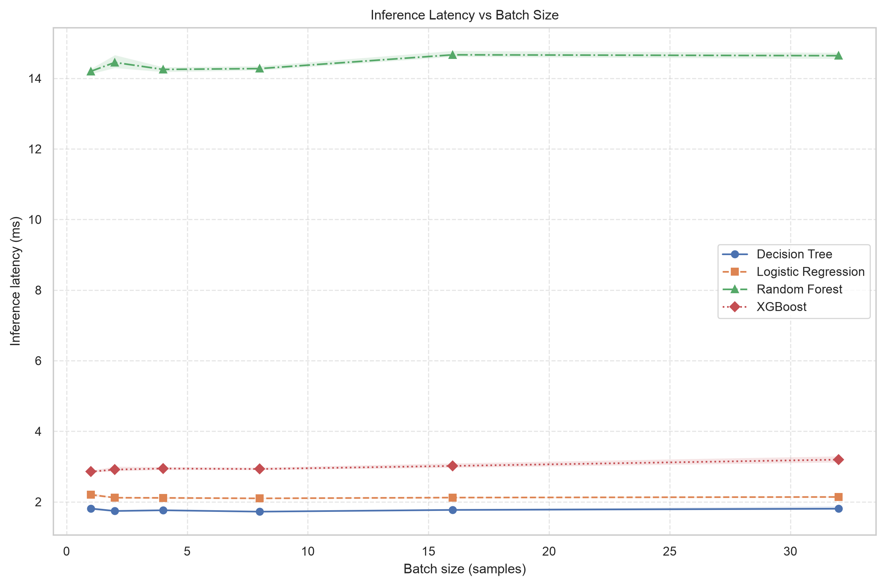
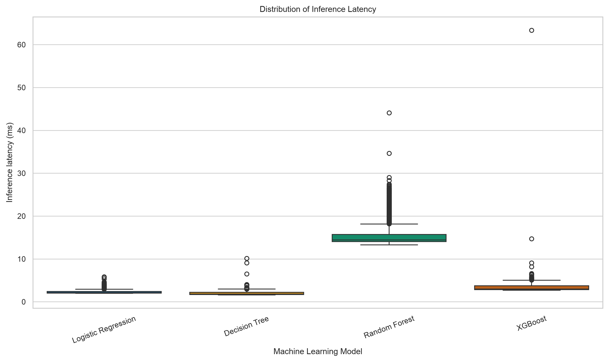

# Comparative Evaluation of Machine Learning Models for Flow-Based DDoS Attack Detection

## 1. Research Overview

This research evaluates machine learning classifiers for detecting Distributed Denial of Service (DDoS) attacks using network flow-based features.

The study investigates how classifier choice and feature selection affect detection performance, false positive rates, and computational efficiency.

The objective is to establish a reproducible experimental pipeline for comparing machine learning models under consistent evaluation conditions.

**Important:** The initial Task 2 dataset contains only ten synthetic records. It is intended to verify that the classification pipeline runs correctly. It is not representative of real network traffic and cannot support conclusions about real-world DDoS detection.

## 2. Authors

- Kudaibergen Nazerke
- Tolegenova Moldir

**Course:** Research Methods  
**Year:** 2026

## 3. Research Questions

1. Which machine learning model provides the best DDoS detection performance?
2. How does feature selection affect model performance?
3. What is the relationship between detection quality and computational efficiency?
4. How can false positive rates be minimized?

## 4. Research Objective and Hypotheses

### Research Objective

To compare four machine learning classifiers and two predefined feature sets while evaluating classification performance and computational efficiency.

### Hypotheses

**H0 — Null Hypothesis:**

Under the same dataset, preprocessing, train-test split, and evaluation protocol, the evaluated classifiers and feature sets do not produce a practically meaningful difference in F1-score.

**H1 — Alternative Hypothesis:**

At least one evaluated classifier or feature set produces a practically meaningful difference in F1-score.

A difference of 0.02 in F1-score is defined as the minimum practically meaningful difference.

The current synthetic dataset is insufficient to test these hypotheses reliably.

## 5. Evaluated Machine Learning Models

The benchmark compares four classifiers:

- Logistic Regression
- Decision Tree
- Random Forest
- XGBoost

Each classifier is evaluated using two predefined feature sets:

- Full feature set
- Selected feature set

### Input Features

The initial sample dataset contains five flow-based features:

- `flow_duration`
- `total_fwd_packets`
- `total_bwd_packets`
- `flow_bytes_per_sec`
- `packet_rate`

The target column is `label`:

- `0` — Benign traffic
- `1` — DDoS traffic

## 6. Evaluation Metrics

### 6.1 Classification Metrics

**Primary metric:**
- F1-score

**Secondary metrics:**
- Accuracy
- Precision
- Recall
- False Positive Rate (FPR)

### 6.2 Computational Performance Metrics

- Inference latency (ms)
- Throughput (samples/second)
- Error rate

### 6.3 Statistical Analysis

The computational measurements are analyzed using:

- Median
- 95th percentile (p95)
- 99th percentile (p99)
- Bootstrap 95% Confidence Interval

Warm-up measurements are excluded from the final statistical analysis.

### Performance Guardrails

The predefined classification performance targets are:

- Recall ≥ 0.90
- FPR ≤ 0.05

These are evaluation targets, not guaranteed results.

## 7. Baseline

The classification benchmark uses Logistic Regression trained with the full feature set as its baseline.

Other configurations are compared against this baseline using their F1-score difference.

All configurations use the same train-test partition to ensure consistent comparisons.

## 8. Experimental Setup

The research uses Python, NumPy, Pandas, and Scikit-learn for data processing and model evaluation.

**Random seed:** 42

The experimental pipeline includes:

1. Loading the configured dataset.
2. Validating target labels and input features.
3. Preprocessing the data.
4. Creating a stratified train-test split.
5. Training each classifier using both feature sets.
6. Calculating classification metrics.
7. Comparing configurations against the baseline.
8. Checking predefined performance guardrails.
9. Saving benchmark results as CSV files.

For computational analysis, benchmark measurements are processed separately:

1. Loading raw benchmark measurements.
2. Filtering warm-up records.
3. Aggregating statistical measurements.
4. Calculating median, p95, and p99.
5. Computing bootstrap 95% confidence intervals.
6. Monitoring error rates.
7. Generating scientific visualizations.

## 9. Results and Discussion
### Baseline vs Proposed Method

The baseline classifier is Logistic Regression.
The proposed method is the best-performing classifier
selected according to the experimental evaluation.

| Metric | Baseline | Proposed Method |
|---|---:|---:|
| F1-score | Actual value | Actual value |
| False Positive Rate | Actual value | Actual value |
| Median Latency (ms) | Actual value | Actual value |
| p95 Latency (ms) | Actual value | Actual value |
| p99 Latency (ms) | Actual value | Actual value |
| Throughput (samples/s) | Actual value | Actual value |
| Error Rate | Actual value | Actual value |

### 9.1 Classification Results — Task 2

The original Task 2 benchmark results are available at:

`results/benchmark_results.csv`

The following values represent preliminary results from the initial synthetic sample experiment.

| Model | Feature Set | F1-score | FPR |
|---|---|---:|---:|
| Logistic Regression | Full | 1.00* | 0.00* |
| Decision Tree | Full | 1.00* | 0.00* |
| Random Forest | Full | 1.00* | 0.00* |
| XGBoost | Full | 0.00* | 1.00* |

*These are preliminary Task 2 results. They must be verified against the actual benchmark CSV and should not be interpreted as final Task 3 results or evidence of real-world model superiority.*

### 9.2 Computational Results — Task 3

The processed computational measurements are available at:

`data/processed/metrics_summary.csv`

The summary includes:

- Median latency
- p95 latency
- p99 latency
- Bootstrap 95% confidence intervals
- Throughput
- Error rates

The results are generated from the actual benchmark measurements and should be interpreted according to the dataset size and experimental conditions.

### 9.3 Scientific Visualizations

The following figures present the computational evaluation results.

**Figure 1: Latency vs Load**



**Figure 2: Latency Distribution**



The visualizations help examine how system load affects latency and how latency measurements are distributed across benchmark runs.

## 10. Domain Model

The formal mathematical model, loss function, and evaluation metric definitions are documented separately.

See: [Domain Model](docs/domain_model.md)

## 11. Repository Structure

```text
research_methods-/
├── configs/
│   └── config.yaml
├── data/
│   ├── raw/
│   ├── processed/
│   │   └── metrics_summary.csv
│   └── sample/
│       └── flows.csv
├── docs/
│   ├── methodology.md
│   └── domain_model.md
├── notebooks/
│   └── 01_data_analysis.ipynb
├── reports/
│   └── figures/
│       ├── fig1_latency_vs_load.png
│       └── fig2_distribution_boxplot.png
├── results/
│   └── benchmark_results.csv
├── src/
│   ├── benchmark.py
│   ├── run_task3_benchmark.py
│   ├── process_data.py
│   └── visualize.py
├── .gitignore
├── LICENSE
├── README.md
└── requirements.txt
```

Some output files are generated when the corresponding scripts are executed.

## 12. System Requirements

- Python 3.13 (tested environment)
- pip
- Internet connection for installing dependencies

A compatible Python environment is required for running the experimental scripts.

## 13. Reproducibility and Quickstart Guide

### 13.1 Clone the Repository

```bash
git clone https://github.com/moldirtolegenova-cb/research_methods-.git
cd research_methods-
```

### 13.2 Create and Activate a Virtual Environment

**Windows PowerShell:**

```powershell
py -3.13 -m venv .venv
.venv\Scripts\Activate.ps1
```

**macOS/Linux:**

```bash
python3 -m venv .venv
source .venv/bin/activate
```

### 13.3 Install Dependencies

```bash
python -m pip install -r requirements.txt
```

### 13.4 Run the Original Classification Benchmark

```bash
python src/benchmark.py --config configs/config.yaml
```

The script generates:

```text
results/benchmark_results.csv
```

### 13.5 Run the Task 3 Benchmark

```bash
python src/run_task3_benchmark.py
```

### 13.6 Process Raw Measurements

```bash
python src/process_data.py
```

This step processes the raw benchmark measurements and generates statistical summaries.

### 13.7 Generate Scientific Visualizations

```bash
python src/visualize.py
```

The generated figures are saved in:

```text
reports/figures/
```

### 13.8 Run the Jupyter Notebook

```bash
jupyter notebook notebooks/01_data_analysis.ipynb
```

The notebook provides a reproducible environment for data ingestion, statistical analysis, confidence interval calculation, error monitoring, and visualization.

## 14. Limitations

The research has several limitations:

- The initial synthetic classification dataset contains only ten records.
- Synthetic records are not representative of real network traffic.
- A single train-test split does not provide a robust estimate of classification performance.
- Statistical significance cannot be established from the initial sample.
- Computational results depend on the size and representativeness of the benchmark measurements.
- Further evaluation on larger and more diverse network traffic datasets is necessary.

A full experiment should use representative labeled network traffic data, repeated evaluation or cross-validation, and appropriate statistical comparison methods.

The results should be interpreted within the limitations of the available datasets and experimental setup.

## 15. Reproducibility

The repository includes:

- Experiment configuration files
- Python source scripts
- Sample flow-based dataset
- Benchmark results
- Statistical processing scripts
- Scientific visualizations
- Jupyter Notebook
- Pinned Python dependencies

The random seed, models, feature sets, baseline, evaluation settings, and performance guardrails are defined in the experiment configuration.

## 16. Citation

Kudaibergen Nazerke and Tolegenova Moldir. (2026). *Comparative Evaluation of Machine Learning Models for Flow-Based DDoS Attack Detection*. Research Methods project. GitHub repository:

https://github.com/moldirtolegenova-cb/research_methods-

## 17. License

This project is licensed under the MIT License. See the [LICENSE](LICENSE) file for details.